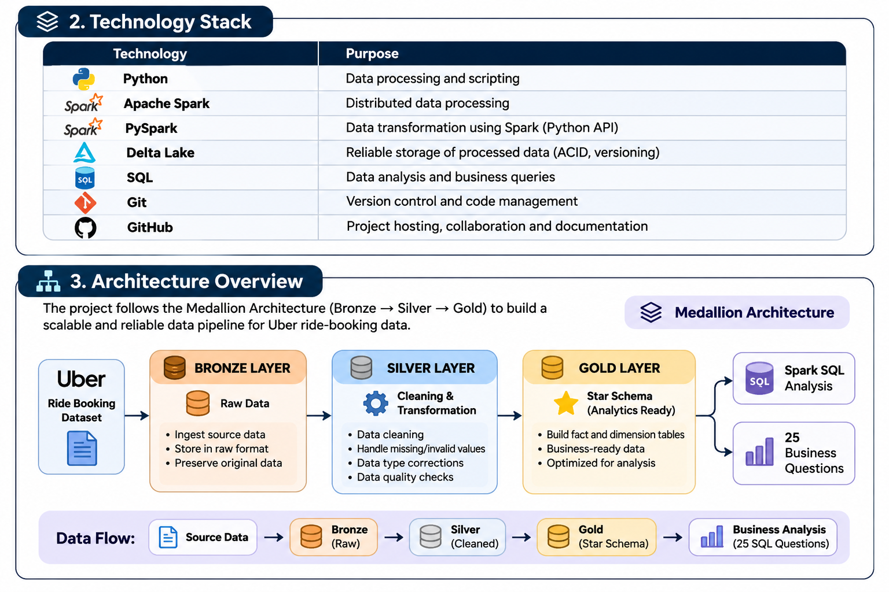

# Uber Ride Booking Data Engineering Project

An end-to-end Data Engineering project focused on building a Lakehouse pipeline using PySpark, Delta Lake, and SQL.

This project transforms raw ride-booking data into structured, reliable, and business-ready datasets to support analytical reporting and business decision-making.

## Project Highlights

- Built an end-to-end data pipeline using Medallion Architecture.
- Processed 150,000 ride-booking records.
- Implemented Bronze, Silver, and Gold layers using Delta Lake.
- Created 6 dimension tables and 1 fact table.
- Designed a Star Schema for analytical querying.
- Performed data quality checks and validation.
- Developed 25 SQL business analysis queries.

## Technology Stack

| Technology | Purpose |
|---|---|
| Python | Pipeline development |
| PySpark | Data processing |
| Apache Spark | Distributed processing |
| Delta Lake | Lakehouse storage |
| Spark SQL | Data querying and analysis |
| MySQL | Database integration |
| Git | Version control |

## Project Architecture



For detailed technical documentation, see [Architecture Documentation](docs/architecture.md).

## Project Structure

```text
uber-data-engineering-platform/
├── data/
├── docs/
├── sql/
├── src/
│   ├── ingestion/
│   ├── transformations/
│   └── validation/
├── jars/
├── README.md
├── requirements.txt
└── .gitignore
```

## SQL Analytics

Developed 25 SQL queries across five business domains:

- Revenue Analysis
- Booking Analysis
- Customer Analysis
- Vehicle and Location Analysis
- Operational Analysis

**SQL Files:**

- [Gold Analytics Queries](sql/gold_analytics.sql)
- [Gold Validation Queries](sql/gold_validation.sql)

## Documentation

- [Project Architecture](docs/architecture.md)
- [Star Schema Data Model](docs/Uber%20Ride%20Booking%20-%20Gold%20Data%20Model.png)

## Getting Started

### Prerequisites

- Python 3.10 or a compatible version
- Java (compatible with your installed Spark version)
- Git

### Installation

1. Clone the repository:

```bash
git clone https://github.com/Mohammedsowban-tp/uber-ride-booking-lakehouse.git
```

2. Navigate to the project directory:

```bash
cd uber-ride-booking-lakehouse
```

3. Create a virtual environment:

```bash
python -m venv .venv
```

4. Activate the environment on Windows:

```bash
.venv\Scripts\activate
```

5. Install the project dependencies:

```bash
pip install -r requirements.txt
```

### Pipeline Execution

Run the scripts in the following order:

**1. Bronze Ingestion**

```bash
python src/ingestion/bronze_ingestion.py
```

**2. Silver Transformation**

```bash
python src/transformations/silver_transformation.py
```

**3. Silver Data Quality Validation**

```bash
python src/validation/silver_quality_check.py
```

**4. Gold Transformation**

```bash
python src/transformations/gold_transformation.py
```

**5. Gold Data Quality Validation**

```bash
python src/validation/gold_quality_check.py
```

### SQL Analysis

Use the Gold-layer Delta tables to execute the business queries in:

- `sql/gold_analytics.sql`
- `sql/gold_validation.sql`

Refer to the architecture documentation for the complete pipeline design.

## Dataset Attribution

This project uses the **Uber Data India** dataset.

- **Creator:** anilrohan
- **Source:** [Kaggle – Uber Data India](https://www.kaggle.com/datasets/anilrohan/uber-data-india)
- **License:** CC BY-SA 4.0

The dataset is used in accordance with its original licence. All credit for the original dataset belongs to its creator.

## Licensing

- Original project code and documentation are licensed under the MIT License (see `LICENSE`).
- The dataset `data/raw/ncr_ride_bookings.csv` is licensed under CC BY-SA 4.0 by its original creator.
- Third-party components, including MySQL Connector/J, remain subject to their respective licences.
