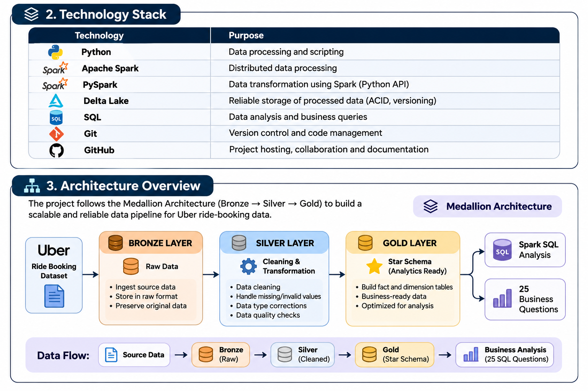

# Uber Ride Booking Lakehouse — Architecture Documentation

## 1. Project Overview

The Uber Ride Booking Lakehouse is an end-to-end Data Engineering project that processes ride-booking data using a Medallion Architecture.

The pipeline transforms raw booking data into structured, business-ready analytical datasets through three layers:

- **Bronze:** Ingested source data stored in Delta format.
- **Silver:** Cleaned, standardized, and type-corrected data.
- **Gold:** Business-ready analytical tables organized using a Star Schema.

The project demonstrates data ingestion, transformation, data quality validation, dimensional modelling, and SQL-based business analysis.

## 2. Technology Stack

The project uses the following technologies:

| Technology | Purpose |
|---|---|
| Python | Pipeline development |
| PySpark | Distributed data processing |
| Apache Spark | Data transformation engine |
| Delta Lake | Storage format for Bronze, Silver, and Gold |
| Spark SQL | Data querying and transformation |
| MySQL | Relational database integration/export component |
| Git | Version control |

The pipeline currently runs locally using Spark's `local[*]` execution mode.

## 3. Architecture Overview

The project follows the Medallion Architecture:

**Source CSV → Bronze → Silver → Gold → SQL Business Analysis**



### Processing Flow

1. The source CSV file is read by the ingestion script.
2. The Bronze layer stores the ingested data in Delta format.
3. The Silver transformation performs data standardization, type conversion, and validation.
4. The Gold transformation creates dimension tables and a fact table.
5. SQL queries use the Gold layer to answer business questions.

## 4. Bronze Layer — Raw Data Ingestion

**Source:** `data/raw/ncr_ride_bookings.csv`

**Output:** `data/bronze/ride_bookings`

The Bronze layer is responsible for ingesting the source dataset and preserving it in Delta format.

### Operations

- Reads the source CSV file using PySpark.
- Uses the CSV header and schema inference.
- Normalizes column names.
- Writes the ingested data in Delta format.

### Purpose

- Maintain an initial persisted copy of the source data.
- Provide a consistent input for downstream transformations.
- Separate ingestion from subsequent data cleaning.

## 5. Silver Layer — Data Cleaning and Transformation

**Input:** `data/bronze/ride_bookings`

**Output:** `data/silver/ride_bookings`

The Silver layer prepares the Bronze data for analytical modelling.

### Data Quality Checks

The transformation includes checks for:

- Required columns.
- Duplicate booking IDs.
- Missing or blank booking IDs.
- Invalid booking statuses.
- Numeric values that cannot be converted to their expected data types.

### Transformations

- Trims whitespace from relevant text values.
- Standardizes booking status capitalization.
- Recognizes five valid booking statuses:
  - Completed
  - Cancelled By Customer
  - Cancelled By Driver
  - No Driver Found
  - Incomplete
- Normalizes text representations of missing numeric values.
- Converts numeric columns into appropriate types, including `DOUBLE`, `INT`, and `DECIMAL(10,2)`.
- Removes records with missing or blank booking IDs.
- Filters out records with unrecognized booking statuses.

### Important Data Quality Note

Duplicate booking IDs are identified and reported during validation. The current transformation does not explicitly deduplicate those records.

The Silver output is stored in Delta format for Gold-layer processing.

## 6. Gold Layer — Dimensional Modelling

**Input:** `data/silver/ride_bookings`

**Output:** `data/gold/`

The Gold layer converts the Silver dataset into a business-oriented analytical model using a Star Schema.

### 6.1 Dimension Tables

The project creates six dimension tables:

| Dimension Table | Description |
|---|---|
| `dim_customer` | Customer information |
| `dim_vehicle` | Vehicle types |
| `dim_location` | Pickup and drop locations |
| `dim_date` | Calendar attributes |
| `dim_payment_method` | Payment methods |
| `dim_booking_status` | Booking statuses |

Surrogate keys are generated for the vehicle, location, payment method, and booking status dimensions.

The date dimension includes:
- Date ID
- Full date
- Day
- Month
- Quarter
- Year

The payment method dimension also includes an Unknown member with ID `0`.

### 6.2 Fact Table

The project creates one fact table:

**`fact_rides`**

The fact table contains booking-level records and connects to the six dimensions.

Its columns include:

- Ride ID and booking ID.
- Customer and dimension keys.
- Pickup and drop location keys.
- Date, payment method, and booking status keys.
- Ride time and operational metrics.
- Booking value and ride distance.
- Driver and customer ratings.
- Cancellation and incomplete-ride information.

**Fact table grain:** One row represents one Silver booking record.

The validated Gold fact table contains **150,000 records and 22 columns**.

### 6.3 Star Schema


Interactive data model: [View the Star Schema on dbdiagram.io](https://dbdiagram.io/d/Uber-Ride-Booking-Gold-Data-Model-6ae9a33e027db74914d433f9)

### 6.4 Role-Playing Dimension

The `dim_location` table is used twice in the fact table:

- `pickup_location_id`
- `drop_location_id`

This is an example of a role-playing dimension. The same dimension provides two different analytical perspectives: pickup locations and drop locations.

The fact table contains seven dimension-key relationships.

## 7. Data Quality and Validation

Data quality checks are performed across the pipeline.

### Silver Validation

- Required-column checks.
- Duplicate booking ID identification.
- Missing and blank booking ID checks.
- Booking status validation.
- Numeric conversion validation.
- Output schema and row-count inspection.

### Gold Validation

- Verification of all six dimension tables and the fact table.
- Record and column count inspection.
- Fact table ride ID uniqueness and null checks.
- Dimension-key matching checks.
- Foreign-key relationship validation.
- Checks for missing keys and invalid analytical values.

The project also includes SQL-based Gold-layer validation queries.

## 8. Business Analytics Using SQL

The Gold layer supports 25 business analysis questions organized into five categories.

| Category | Questions |
|---|---:|
| Revenue Analysis | 5 |
| Booking Analysis | 5 |
| Customer Analysis | 5 |
| Vehicle and Location Analysis | 5 |
| Operational Analysis | 5 |
| **Total** | **25** |

These queries investigate:

- Revenue and booking value.
- Booking trends and status distribution.
- Customer behaviour.
- Vehicle performance.
- Pickup and drop location patterns.
- Cancellations and operational performance.

The queries are maintained in:

`sql/gold_analytics.sql

Gold validation queries are maintained in:

`sql/gold_validation.sql`

## 9. Project Structure

```text
uber-data-engineering-platform/
│
├── data/
│   ├── raw/
│   ├── bronze/
│   ├── silver/
│   └── gold/
│
├── docs/
│   ├── architecture.md
│   ├── architecture_overview.png
│   └── Uber Ride Booking - Gold Data Model.png
│
├── jars/
│
├── sql/
│   ├── gold_analytics.sql
│   └── gold_validation.sql
│
├── src/
│   ├── ingestion/
│   │   ├── bronze_ingestion.py
│   │   ├── download_dataset.py
│   │   └── gold_to_MySql.py
│   │
│   ├── transformations/
│   │   ├── silver_transformation.py
│   │   └── gold_transformation.py
│   │
│   └── validation/
│       ├── silver_quality_check.py
│       ├── gold_quality_check.py
│       └── inspect_dataset.py
│
├── README.md
├── requirements.txt
└── .gitignore
```

## 10. Project Outcome

The project demonstrates an end-to-end local Data Engineering workflow using PySpark, Delta Lake, and SQL.

Completed components include:

- CSV data ingestion.
- Bronze, Silver, and Gold Delta layers.
- Data profiling and validation.
- Data cleaning and type conversion.
- Dimensional data modelling.
- Six dimension tables and one fact table.
- Star Schema with seven dimension-key relationships.
- Gold-layer validation.
- 25 SQL business analysis questions.

## 11. Future Enhancements

Potential improvements include:

- Building an interactive Power BI dashboard.
- Improving pipeline configuration and execution.
- Adding automated regression tests.
- Exploring performance optimization for larger datasets.

**Project architecture:** Medallion Architecture  
**Data modelling:** Star Schema  
**Execution environment:** Local Apache Spark